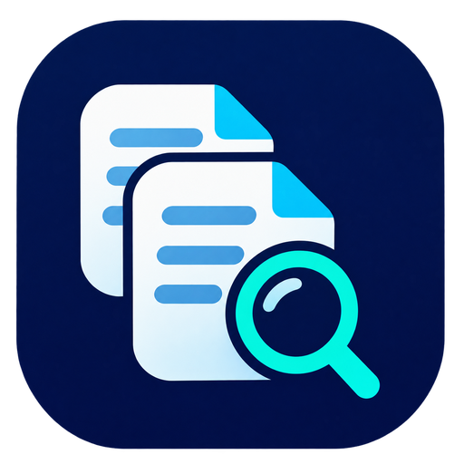

# DupliGo

**Find and review duplicate files on Windows.**

DupliGo is a desktop application written in Go with [Fyne](https://fyne.io/). It scans a folder and its subfolders, identifies files with matching SHA-256 hashes, and presents the results in expandable groups so you can review them before taking action.



> **Project status:** Early preview. Test with non-essential files first. Windows builds will be available from GitHub Releases once published.

## Features

- Recursively scan a selected folder for regular files.
- Filter files by size before hashing to reduce unnecessary disk reads.
- Group matching files using SHA-256 hashes, even when their names differ.
- Browse results in expandable groups and select individual files.
- Request moving selected files to the Windows Recycle Bin, with a confirmation prompt.
- Keep the interface responsive while scanning.

## Download and run on Windows

1. Visit the [DupliGo Releases page](https://github.com/jjavier2005/dupligo/releases).
2. Open a published Windows release and download **`DupliGo.exe`** from **Assets**.
3. Move `DupliGo.exe` to a folder you plan to keep (for example, `C:\Apps\DupliGo\`).
4. Double-click `DupliGo.exe` to launch it. No Go installation is required for a prebuilt executable.
5. **Optional desktop shortcut:** right-click the executable, choose **Show more options → Send to → Desktop (create shortcut)** (wording varies by Windows version).

**No release listed yet?** A runnable binary has not been published; follow the build instructions below instead. GitHub's **Code → Download ZIP** downloads source code, not a ready-to-run Windows application.

Unsigned community builds may trigger a Windows security warning. Only run a file you trust and have verified came from this repository.

## How to use

1. Click **Choose folder** and select a directory.
2. Click **Scan** and wait for the results.
3. Expand each matching group and review the full file paths.
4. Select only the copies you want to remove from their current locations.
5. If the Recycle Bin action is available, review the confirmation carefully before proceeding.

**Important:** Matching SHA-256 hashes are a highly reliable indicator, but not a mathematical guarantee of identical content. Files can also change after a scan. Check your selections; the app may allow every file in a group to be selected. Recycle Bin behavior depends on Windows and the storage volume. Use it with small folders for now (less than 10000 files).

## Build from source

**Requirements:** Windows, a compatible Go toolchain and the C compiler required by Fyne.

```powershell
git clone https://github.com/jjavier2005/dupligo.git
cd dupligo
go mod download
go test ./...
go run .
```

### Create a Windows executable with an icon

The application icon lives at `assets/Icon.png`. Install the official Fyne command-line tool, then package the application:

```powershell
go install fyne.io/tools/cmd/fyne@latest
fyne package -os windows -name DupliGo -icon assets/Icon.png -release
```

This produces a Windows application executable with embedded icon metadata. If PowerShell cannot find `fyne`, ensure the Go `bin` directory is in your `PATH` (usually `%USERPROFILE%\go\bin`).

To create a desktop shortcut, keep the executable in a permanent folder and use Windows' **Send to → Desktop (create shortcut)** option. Moving or renaming the executable later can break the shortcut.

## Project structure

```text
dupligo/
├── main.go                 # Application setup and scan coordination
├── internal/
│   ├── ui/                 # Fyne windows and user interaction
│   ├── scanner/            # Recursive file discovery
│   ├── duplicates/         # Size filtering and SHA-256 matching
│   └── recycle/            # Windows Recycle Bin integration
└── assets/
    └── Icon.png            # Application icon
```

## Development

Run all tests before contributing:

```powershell
go test ./...
```

DupliGo is a learning and portfolio project. Feedback, bug reports and contributions are welcome through [GitHub Issues](https://github.com/jjavier2005/dupligo/issues).
